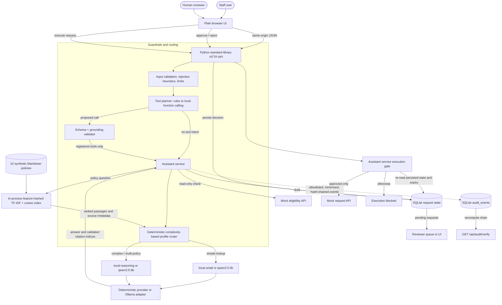

# Governed Service Assistant

[](https://github.com/saoudhaidar/ai-executive/actions/workflows/ci.yml)

A dependency-free local prototype for grounded policy Q&A, synthetic eligibility checks, and human-approved service requests. The UI and API run on Python's standard library; request state and audit events are stored in SQLite.

## Run locally

Requires Python 3.11 or newer. No packages or API keys are needed.

```sh
python3 -m governed_assistant
```

Open [http://127.0.0.1:8000](http://127.0.0.1:8000). The server binds to loopback by default. Stop it with Ctrl+C. Each launch records its own PID under `.data/assistant.pid`; a later launch stops that recorded assistant process before binding the port, while leaving unrelated processes untouched.

To run in a container instead (non-root image, SQLite on a volume):

```sh
docker build -t governed-assistant .
docker run --rm -p 8000:8000 -v assistant-data:/data governed-assistant
```

Optional environment settings are listed in [.env.example](.env.example). Export them in your shell before starting the server; `.env` files are not automatically loaded. Runtime SQLite data is created under `.data/`.

## Architecture



The UI sends policy questions, eligibility checks, and request workflow actions to the local API. Policy questions pass validation and injection heuristics; when a question names a policy, retrieval is restricted to that document and ranks up to five passages. The router selects one deterministic profile and the extractive provider selects answer sentences from retrieved text, returning document/section citations—not free-form LLM output. Chat messages that name a synthetic customer and ask to check eligibility or raise a request are turned into a tool proposal by the planner; the service validates the proposal against a registered schema before running it, so a planner proposes and application code decides. Request preparation persists a pending draft; a reviewer action updates SQLite, and the execution endpoint re-reads approval and expiry state immediately before calling the mock request API. Workflow records and the minimized audit table share the local SQLite database. This diagram intentionally reflects the offline, dependency-free implementation: it does not use Streamlit, FastAPI, hosted models, or a vector database. For detailed trust boundaries and failure handling, see [docs/architecture.md](docs/architecture.md).

### Governance controls at a glance

| Control | Where it is enforced | Proven by |
| --- | --- | --- |
| Human approval gate | `AssistantService.execute_request` re-reads persisted state and expiry; requester ≠ reviewer | `tests/test_core.py`, `approval-*` eval cases |
| Tool governance | `governed_assistant/tools.py`: registry has no approve/execute tool; schema validation; customer ID must appear in the request; drafting requires an `ELIGIBLE` back-end result | `tests/test_tools.py`, `chat-tool-*` eval cases |
| Model selection and routing | `ModelRouter` sends simple vs. complex/multi-policy questions to different tiers; failures degrade to the offline provider at the same tier | `tests/test_models.py`, `tests/test_core.py` |
| Cost limits | Per-session cost cap, turn cap, tool-attempt cap, input/output token limits; measured Ollama token usage when available | `tests/test_core.py` |
| Prompt-injection defence | Input heuristics → optional guardian model (blocks are refusals, not fallbacks) → untrusted passages wrapped in `<passage>` blocks → policy-file instruction filtering | `tests/test_models.py`, `injection-*` eval cases |
| Audit trail | Allowlisted, PII-minimised events in a SHA-256 hash chain; `GET /api/audit/verify` finds the first edited or deleted row | `tests/test_audit_chain.py`, `audit-tamper-detected` eval case |

### Two model modes

The default `deterministic` mode uses the offline extractive provider and is used by tests and evaluations. Set `ASSISTANT_MODEL_MODE=ollama` to route simple questions to `qwen3.5:4b` and complex questions to `qwen3.5:9b` through Ollama's local OpenAI-compatible endpoint. Optionally set `ASSISTANT_OLLAMA_GUARDIAN_MODEL=granite3-guardian:2b` for a second local guardrail; the deterministic injection filter always runs first. Ollama failures, timeouts, malformed responses, ungrounded citations, and fallback conditions return to the extractive provider. Every Ollama answer must cite a retrieved document/section pair; unknown citations are rejected. Set `ASSISTANT_TOOL_PLANNER=ollama` to let the simple model propose tool calls through local function calling; forbidden tools, invalid arguments, or customer IDs that are not in the request are discarded in favour of the rule-based planner.

## Key decisions and trade-offs

| Decision | Benefit for this demo | Trade-off / alternative |
| --- | --- | --- |
| Python standard library, plain browser UI, and SQLite | No dependency installation, API keys, or hosted services; straightforward local setup | Minimal framework support and a single-process development server; not a deployment architecture |
| Feature-hashed TF-IDF and cosine similarity, weighted toward passage text | Deterministic, offline retrieval over the policy files | Lexical matching can miss paraphrases or rank noisy passages; no learned embeddings, managed vector database, or policy-version service |
| Local extractive provider with deterministic routing profiles | Reproducible, source-bound answers without third-party data transfer | `local-small` and `local-reasoning` are profiles, not actual language models; estimated cost uses illustrative rates, not provider billing |
| Persisted approval state checked again at execution | Pending, rejected, expired, and failed requests cannot pass the application-level approval gate | Reviewer IDs are caller-supplied strings, not authenticated identities or authorization roles |
| Planners propose, code disposes | A model can suggest a tool call but cannot reach approval or execution, invent a customer, or skip the eligibility precondition | Adds a validation layer per tool; rule-based intent detection is narrow by design |
| Minimized, hash-chained SQLite audit events | Shows role labels, policy references, workflow decisions, model profile, usage, and outcomes without raw customer IDs or full prompts; edits and deletions are detectable | A local chain detects tampering but cannot prevent a full rewrite by someone with database access; no retention/deletion controls or audit access policy |

### Path to Production

| Prototype choice | Production direction | Trade-off |
| --- | --- | --- |
| Synthetic Markdown and lexical retrieval | Versioned policy service and retrieval benchmark; evaluate a governed embedding/index | Better semantic recall adds model, data-residency, and operations costs |
| Local extractive profiles and illustrative token/cost estimates | Approved model adapter, versioned prompts, measured billing, and enforced budget controls | More capable answers introduce provider, privacy, latency, and cost dependencies |
| Caller-supplied reviewer IDs and SQLite gate | Authenticated identities, role-based authorization, and durable transactional storage | Stronger assurance requires identity and database operations |
| Heuristic injection checks and minimized local audit | Defense-in-depth input/output controls, monitored audit integrity, and retention policy | Stronger controls require ongoing security operations and governance |

These are prototype choices, not general recommendations for production. See [docs/design-decisions.md](docs/design-decisions.md) for additional rationale and [docs/production-roadmap.md](docs/production-roadmap.md) for the next steps.

## Demonstration

1. Ask, “What documents are required for rental assistance?” Expand the source citations.
2. In the chat, ask “Is C-1003 eligible for rental assistance?” The assistant calls the read-only eligibility tool and labels the result as a back-end decision. The form on the right does the same without chat.
3. In the chat, ask “Raise a rental assistance request for C-1001.” The assistant checks eligibility, drafts the request, and stops at `PENDING_APPROVAL`; nothing reaches the request backend. Try the same for `C-1002`; no draft is created because the customer is ineligible.
4. Approve from the pending queue with a reviewer ID different from the requester. The approved queue exposes execution; reject is also available on pending requests. Confirm the returned reference and audit events.
5. Try execution before approval or ask the assistant to ignore its instructions; both are blocked and recorded.
6. Check the audit panel: it shows whether the hash chain is intact. Edit a row in `.data/assistant.sqlite3` and refresh to see the break detected.
7. Run either evaluation listed under [Evaluation](#evaluation) to show a pass/fail report.

To try the optional local tiers, start Ollama and ensure the models are available, then launch:

```sh
ASSISTANT_MODEL_MODE=ollama \
ASSISTANT_OLLAMA_GUARDIAN_MODEL=granite3-guardian:2b \
python3 -m governed_assistant
```

## Evaluation

All entry points use the shared evaluator in [eval/run_eval.py](eval/run_eval.py). The root demo runner and the compatibility script select different datasets; they do not contain separate evaluator implementations.

| Purpose | Command | Dataset |
| --- | --- | --- |
| Presentation demo | `python3 run_eval.py` | [tests/eval_set.json](tests/eval_set.json) — 13 cases |
| Full workflow regression | `python3 eval/run_eval.py --verbose` | [eval/cases.json](eval/cases.json) — 25 cases |
| Compatibility entry point for the full regression set | `python3 scripts/evaluate.py --verbose` | [eval/cases.json](eval/cases.json) — same 25 cases |

The root [run_eval.py](run_eval.py) is a thin entry point for the demo command and defaults to the presentation set. [scripts/evaluate.py](scripts/evaluate.py) remains a compatibility entry point for the broader regression set. Both report pass/fail results, measured latency, and illustrative simulated cost.
The regression command also writes [eval/latest_report.json](eval/latest_report.json), including
per-category pass rates, top-5 retrieval hit rate and mean reciprocal rank (MRR) for policy questions, simulated input/output tokens, cost totals, and the active environment mode.

Latest regression run: 25/25 cases pass; retrieval hit rate 1.00 and MRR 0.73 over 9 policy questions. The MRR shows that the expected passage is not always ranked first, which is the main argument for testing a learned embedding or reranker next (see the roadmap).

CI runs the unit tests and the regression evaluation on Python 3.11–3.13 for every pull request, so a regression in grounding, the approval gate, tool governance, or audit integrity fails the build.

## Tests

```sh
python3 -m unittest discover -s tests -v
```

The unit suite covers policy citations and unsupported questions, prompt injection in user input and policy content, guardian verdict parsing, passage spotlighting, backend eligibility labeling, chat tool planning and validation, approval enforcement, rejection, audit PII minimization, hash-chain tamper detection, and HTTP behavior. See [Evaluation](#evaluation) for the presentation and full workflow commands; the broader set includes failed and expired approval states.

## Prototype scope and limitations

- **Data and retrieval:** all policy content and customer records are synthetic. The in-process feature-hashed TF-IDF index is rebuilt from Markdown at startup; it is not a learned embedding model or managed vector store. Retrieval uses up to five passages and remains lexical. Injection checks use heuristics and are not comprehensive defenses; they can also over-block, for example “Can I open a case without review of documents?” is refused.
- **Answer generation and measurement:** the provider extracts policy sentences; it is not an LLM and does not demonstrate generative quality. The router profiles are deterministic. Token usage is a whitespace-based estimate, and cost uses illustrative per-profile rates; it is neither billed nor a prediction of future hosted-model costs.
- **Back-end integrations:** eligibility and request operations use mock APIs only; no real service or customer system is contacted.
- **Identity and authorization:** actor and reviewer IDs are submitted by the caller and are not authenticated. The different-ID approval check demonstrates workflow separation, but does not prove a human reviewer’s identity or permission.
- **Tool planning:** the rule-based planner only recognises explicit eligibility or request phrasing with a `C-####` ID and only supports rental assistance. It performs one tool call per turn.
- **Local model option:** Ollama tiers remain local-process integrations, not production model governance. The adapter validates citations and falls back deterministically, but does not provide model quality guarantees.
- **Operations and persistence:** this is a single-process local demo, not hardened for exposure to an untrusted network. Workflow and audit records persist in SQLite; mock API idempotency results are in memory and do not survive a restart.
- **Production readiness:** do not use this prototype for real customer decisions or consequential service requests. Production would require authenticated authorization, secure deployment and storage, stronger privacy and audit controls, resilient integrations, policy/model versioning, and continuous evaluation. See [docs/production-roadmap.md](docs/production-roadmap.md).

## Project map

- [governed_assistant/](governed_assistant/) — policy retrieval, model routing, governed tool planning (`tools.py`), workflow rules, API, and SQLite persistence.
- [.github/workflows/ci.yml](.github/workflows/ci.yml) and [Dockerfile](Dockerfile) — CI evaluation gate and container image.
- [web/](web/) — single-page demonstration UI.
- [data/policies/](data/policies/) — ten synthetic service policy documents.
- [tests/](tests/) and [eval/](eval/) — unit tests, the presentation set, and the offline workflow regression set. See [Evaluation](#evaluation) for their shared runner and command distinctions.
- [docs/architecture.md](docs/architecture.md), [docs/design-decisions.md](docs/design-decisions.md), and [docs/production-roadmap.md](docs/production-roadmap.md) — architecture, trade-offs, and production gaps.
- [docs/lessons.md](docs/lessons.md) — a practical note about running project scripts.
