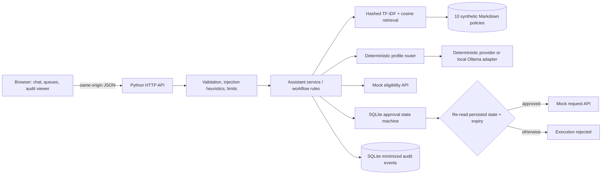
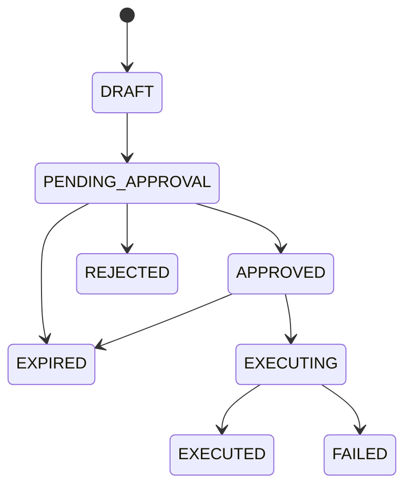

# Architecture

## Components and trust boundaries

Browser input, retrieved policy text, and mock-service responses are untrusted data. The API validates request shapes and limits body size; the service validates identifiers and service codes. Prompt-injection checks block recognized user patterns and exclude recognized instruction-like policy sentences, but these lexical heuristics are not comprehensive defenses. The deterministic provider only extracts sentences from retrieved passages. In optional Ollama mode, the adapter sends only the retrieved context to local models, validates returned citations against that context, and falls back to deterministic extraction on failure. No provider can approve or execute requests. The browser shows citations and usage badges, pending and approved queues with reviewer actions, and the minimized audit history.

## Request flows

### Policy answer

1. Browser sends a question, actor ID, and conversation ID to `POST /api/chat`.
2. The API validates JSON and body size. The service blocks known prompt-injection patterns and enforces input/session limits.
3. If the question names one or more policy titles, `PolicyIndex` restricts retrieval to those documents. It ranks up to five passages by cosine similarity over deterministic feature-hashed TF-IDF vectors, combining document/section metadata and passage-text similarity with more weight on passage text.
4. `ModelRouter` selects a configured profile. Deterministic mode uses `local-small` or `local-reasoning`; optional Ollama mode uses `qwen3.5:4b` or `qwen3.5:9b` and validates every returned `[Document §Section]` citation. Provider failures or budget overflow use deterministic extraction; no passages means an explicit “not found” response.
5. The service returns answer, document/section/excerpt citations, route, whitespace-estimated token counts, illustrative simulated cost and latency, and writes a minimized audit event.

### Chat tool call

1. After input screening, the configured planner inspects the message. The rule-based planner needs a `C-####` customer ID plus explicit eligibility or request wording; the optional Ollama planner uses local function calling with the same registered tool schemas.
2. `validate_proposal` rejects tools that are not registered, missing or unexpected arguments, values that fail the schema, and customer IDs that do not appear in the staff message.
3. `check_eligibility` calls the read-only eligibility path. `prepare_service_request` runs the eligibility check first and drafts a `PENDING_APPROVAL` request only for an `ELIGIBLE` result. No tool can approve or execute.
4. A `tool_call_planned` audit event records the tool, planner, side-effect class, and outcome, without the customer ID.

### Eligibility

`POST /api/eligibility` validates the synthetic customer ID and service code, enforces the tool-attempt limit, then calls the mock eligibility backend. Its result is labeled as a back-end decision, distinct from policy guidance.

### Service request

`POST /api/requests` creates a pending draft for a synthetic customer and service. A different reviewer must call `/api/requests/{id}/approve` or `/reject`. `POST /api/requests/{id}/execute` independently reads SQLite and only changes an unexpired `APPROVED` record to `EXECUTING` before calling the mock backend. Success transitions to `EXECUTED`; known outages and unexpected adapter exceptions transition to `FAILED` with sanitized metadata. Repeated or unapproved execution is rejected. SQLite `BEGIN IMMEDIATE` serializes competing state transitions; the mock service also uses the request ID as an idempotency key.

## Contracts and data ownership

- **API:** JSON over same-origin HTTP; errors use 4xx/5xx status codes and an `error` field. The development server binds to loopback.
- **Policy source of truth:** Markdown files in `data/policies/`; the index is rebuilt in memory at startup.
- **Workflow source of truth:** SQLite `service_requests`, updated only through state-checked service methods.
- **Audit source of truth:** SQLite `audit_events`, hash-chained with SHA-256 (`prev_hash`, `entry_hash`) so `GET /api/audit/verify` can find the first edited or deleted row; role labels replace raw actor IDs, and question text, customer IDs, and free-form customer data are not included. Workflow records are separate and do contain synthetic customer IDs to support the demo.
- **External systems:** in-process mock APIs; deterministic mode makes no network calls. Optional Ollama mode makes loopback-only calls to the configured local endpoint.

## Routing, limits, and observability

The router chooses `local-small` for straightforward questions and `local-reasoning` for longer, explicitly comparative, or multi-policy questions. In Ollama mode those routes map to `qwen3.5:4b` and `qwen3.5:9b`; `granite3-guardian:2b` is optional after the deterministic injection pre-filter. Input/output token counts use whitespace tokenization; costs use illustrative per-profile rates and are not actual inference charges. Settings for routes, input/output limits, turn count, session cost cap, tool attempts, approval expiry, endpoint, timeout, and Ollama mode are configurable through environment variables. Policy audit events include selected provider/profile, policy references, token counts, simulated cost basis, and elapsed time.

## Failure behavior

- Empty or invalid API inputs fail explicitly with a 400 response.
- Questions with no relevant policy passages return an unsupported answer without citations.
- Recognized injection-like user instructions are refused; suspicious instruction sentences in policy files are excluded from indexing. This is heuristic defense, not a complete prompt-injection solution.
- Invalid, rejected, expired, or unapproved request transitions fail without invoking the request backend.
- Mock backend outage or unexpected adapter failure marks execution `FAILED`; the API returns 503.
- Ollama timeout, malformed output, ungrounded citation, or unavailable local server falls back to deterministic extraction; the default mode never makes a network call.
- Audit/database failures are surfaced by the API rather than converted into successful results.

## Scale and evolution

This single-process design is for a small local demo. At 10x data or concurrent users, move policy indexing to a versioned external vector store, use a production API server and identity provider, add a durable queue and backend idempotency, and migrate workflow/audit data to a managed database with transactional access controls. Add a real model provider only after data-residency, privacy, evaluation, and cost policies are approved.
